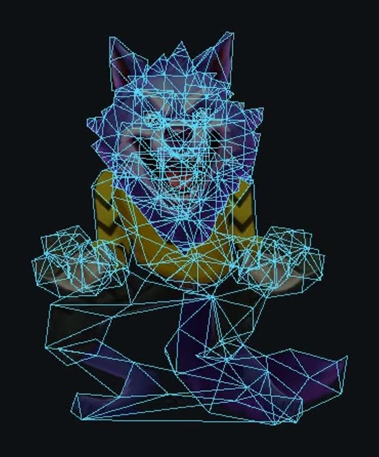
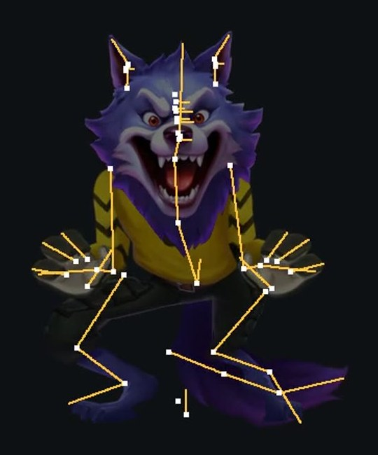

# AutoSpine 盲測報告

新增 [人工綁定＋影片新動作・宙斯與冰屋](2026-10-27-awp-video-reference-0516/artist-rig-motion-02/index.html)：兩份其他素材共四段，完整通過 0/4，有效檢查 11/17 項，另 1 項未判定。保留人工 219／507 骨與網格權重；宙斯的大動作與電弧、冰屋的局部冰磚位置仍需修正。附兩份可編修 Spine、四段對照及官方 Spine 原生骨架影片。原九段 0/9 不改寫。

新增 [人工綁定＋影片新動作](2026-10-27-awp-video-reference-0516/artist-rig-motion-01/index.html)：依使用者新授權保留人工 135 骨、佈線與權重，先清空原動畫，再從 MOV 重做 Idel_02。輪廓平均 0.936、節奏差 0 幀；4/5 項通過，局部位置仍不合格，嘴部拉伸需檢視。附可編修專案、Spine 原生骨架動畫與綁定一致性核對。此模式與全自動建骨分開，原九段成績不變。

新增 [2026-10-27 影片重建改善](2026-10-27-awp-video-reference-0516/improvement-01/index.html)：本機未發布修正版的貓咪 Idel_02 候選通過 4/5 項，部件位置仍未通過；節奏改善伴隨部件誤差中位數略增，完整數據與取捨已列出。附新對照影片、Spine 原生骨架動畫、可編修專案與往返核對。原九段成績維持 0/9 全項通過。

新彩球素材只完成修正後匯入與首幀回歸檢查，因位置偏移停止，未當成未見素材盲測通過。通用修正已加入本機外掛來源與 Skill，安裝版本尚未替換；逐動畫 MOV、隔離與報告整理仍只屬比較測試流程。

新增 [2026-10-27 AWP 影片參考測試（AutoSpine 0.5.16）](2026-10-27-awp-video-reference-0516/index.html)：貓咪王、宙斯、極地王者各三段，共九段。三份原檔 SHA-256 前後一致；從乾淨圖像配置及 MOV 重建，未用原作動畫數值調校。九段均未全項通過，和下方歷史四案分開計算。

本輪附對照影片、可編修 Spine 專案 ZIP、Spine 原生骨架輸出與輸入／擬合／往返數據。貓咪兩側鬍鬚骨鏈方向已依回饋修正。使用者要求背景執行，實際編輯器介面的佈線與骨架畫面尚待檢視。

成績以 2026-10-17 起用目前引擎重測的 4 個角色、18 段動畫為準，並附製作流程與對照影片。

[完整 HTML 報告](autospine-blind-report.html) · [下載專案 ZIP](https://github.com/Wayne188-yiching/AutoSpine/archive/refs/heads/main.zip)

GitHub 會顯示 HTML 原始碼。下載並解壓後，開啟本資料夾的 `autospine-blind-report.html`，即可瀏覽報告數據、縮圖並播放影片。

要給別台電腦看：在有影片的本機執行 `node tools/pack-blind-report.mjs`，會產生 `docs/local-reviews/autospine-blind-report-portable.zip`（報告與所有連到的圖片、影片、數據）。對方解壓後雙擊 `autospine-blind-report.html` 即可，不需架伺服器。ZIP 含美術影片，請只用內部管道傳遞。

## 影片

GitHub 只放報告上有出現的影片：主報告 26 支、Panda 驗收頁 5 支，放在各角色的 `video/` 與 `compare/` 資料夾。其他測試影片與製作檔不放 GitHub，請存放在 `docs/local-reviews/`。

報告資料夾下的 `.mp4` 仍列在 `.gitignore`，新增報告影片時用 `git add -f` 逐支加入，只收報告引用到的檔案。

## 目前狀態

成績以重測的 4 個角色為準，2026-10-13–14 的舊批次成績不再採用。4 個角色製作時都參考了原作，屬樣本內，還不是未見原作的盲測。

報告中的 15 個角色列為未來測試樣本，目前均待測試。

## 目前成績（2026-10-17–19）

| 角色                     | 段數 | 結果             | 通過項 |
| ------------------------ | ---- | ---------------- | ------ |
| Panda（10-18）           | 5    | 參考比對通過     | 18/18  |
| 被窩上班族 Idle（10-18） | 1    | 參考比對未通過   | 2/4    |
| Pig（10-17）             | 7    | 人工檔比對未通過 | 46/54  |
| 木乃伊貓（10-19）        | 5    | 參考比對未通過   | 8/18   |

木乃伊貓、Panda、被窩上班族共 11 段的參考影片比對：

| 檢查項目   | 通過 |
| ---------- | ---- |
| 輪廓       | 7/11 |
| 部件位置   | 5/11 |
| 節奏與幅度 | 9/11 |
| 循環接點   | 6/6  |

尚無任何一段獲美術驗收。量化檢查通過不代表美術驗收完成，仍需看影片確認。

## 網格與骨架

