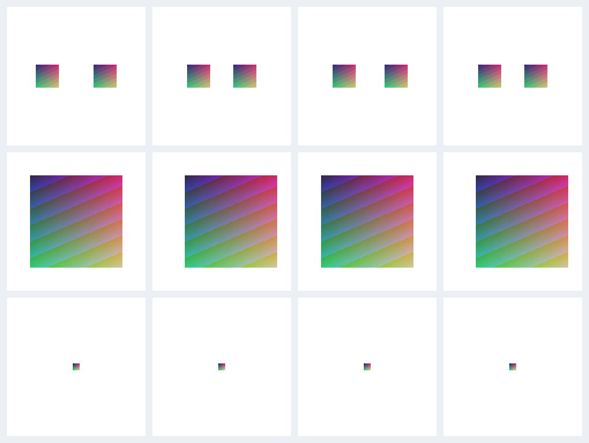

# 程式碼研究後的合成回歸測試

這份報告只使用合成部件，檢查定位控制、鎖定旋轉及可見證據分母。圖中沒有原始角色素材；結果不代表真人角色的美術驗收。

第一列比較兩個加權部件的獨立平移，第二列比較旋轉鎖定時的純平移，第三列檢查投影很小的部件是否具有足夠可見證據。第三列改進的是拒絕證據不足的擬合，並非圖片位置。

| 案例               | 修改前                       | 修改後                      |
| ------------------ | ---------------------------- | --------------------------- |
| 加權部件獨立移動   | 頂點 RMS 3.5355 px           | 0 px                        |
| 旋轉鎖定、只做平移 | 頂點 RMS 8 px                | 0 px                        |
| 微小可見區域       | 1,600 個紋理樣本掩蓋證據不足 | 36 個不同可見像素，拒絕擬合 |

比較基準是工作開始時的未提交工作區快照，不是乾淨發行版。完整輸入、數據與限制見 [results.json](results.json)、[驗證紀錄](validation.json) 與 [程式組成及原理研究](../../research/competitor-code-study-20261028.html)。
